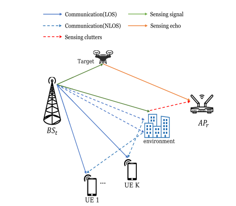
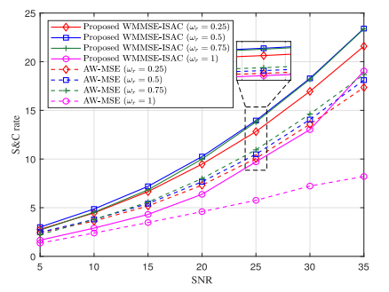
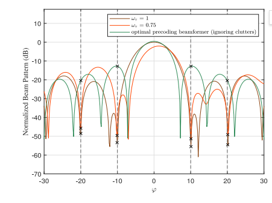
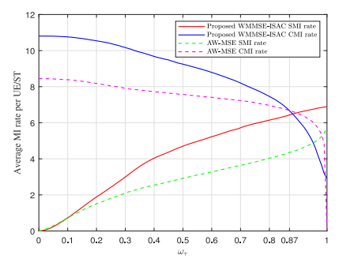
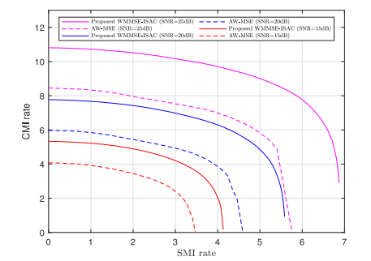

# ISAC: Integrated Perception and Communication Based on Mutual Information: A WMMSE Framework

1. Abstract: This paper investigates an integrated perception and communication (ISAC) method based on Weighted Minimum Mean Square Error (WMMSE). The method considers a system consisting of a transmitting base station and a receiving wireless access point, serving multiple users and a perceptual target simultaneously. Inspired by the theory of mutual information (MI), this paper constructs a unified framework for perception and communication and uses the communication mutual information (CMI) rate and the perceptual mutual information (SMI) rate as performance metrics in scenarios with clutter interference.
Specifically, this paper proposes a novel MI-based WMMSE-ISAC method aimed at maximizing the weighted sum rate of the system's perception and communication. This maximization process is realized through the classic WMMSE method, which better addresses the impact of perceptual clutter interference and inter-user interference. Numerical simulation results validate the effectiveness of the proposed method, while also confirming the performance trade-off relationship between perception and communication.
2. Introduction: In recent years, research interest in next-generation wireless networks (such as B5G, 6G) has been steadily increasing. With the advancement of innovative applications such as Vehicular-to-Everything (V2X) and Internet of Things (IoT), future wireless systems are expected to play a key role in various perception services, including target tracking and environmental monitoring. To achieve this goal, the integrated perception and communication (ISAC) technology offers a highly promising framework that seamlessly integrates perception functions into communication systems, becoming one of the core technologies of next-generation networks.
Under the ISAC framework, numerous solid research achievements have been made, such as some studies using reach rate or signal-to-interference-plus-noise ratio (SINR) as communication performance metrics. However, there are various measures for perceptual performance: some use false alarm probability (PFA) to quantify perceptual performance, others use signal-to-interference-and-noise ratio (SCNR), and others evaluate perceptual accuracy through Cramer-Rao bound (CRB). This issue of inconsistent "communication - perception" metrics often leads to complex system optimization processes; moreover, most existing studies focus on single-antenna users and ignore the significant impact of clutter interference on perceptual performance in real scenarios, making it difficult to meet the requirements for beamforming design in complex scenarios with multi-antenna users and clutter interference.
The characteristics of mutual information (MI) provide a solution to these issues. According to related research, communication mutual information (CMI) has clear engineering significance —— corresponding to the maximum achievable channel coding rate and directly related to SINR/SNR; while perceptual mutual information (SMI) is highly similar in both physical meaning and mathematical form to CMI. Inspired by this, this paper adopts the approach of measuring perceptual performance based on SCNR, using SMI-based perceptual rate (related to SCNR) as the perceptual metric, thereby achieving unified "communication - perception" metrics, allowing classic optimization methods in the communication field to be ported to ISAC systems.
Based on this, this paper proposes an unified WMMSE-ISAC algorithm based on the mutual information framework. The algorithm constructs the problem of beamforming design for complex scenarios with multiple antenna users, perceptual targets, and clutter interference coexisting, maximizing the weighted sum rate of communication and perception under the condition of satisfying the maximum power constraint. By using the classical WMMSE method, the originally non-convex optimization problem is transformed into a convex problem, and finally solved through a simple iterative process. Numerical simulation results verify the effectiveness of the algorithm.
III. Conclusion This paper proposes a unified WMMSE-ISAC framework, addressing the scenario of multi-antenna users and perception targets with clutter interference, constructing a joint perception and communication beamforming design problem. The goal is to maximize the weighted sum rate of perception and communication, which is achieved through the proposed algorithm.
The results show that the proposed algorithm can effectively optimize the overall performance of ISAC systems under different demands: in response to clutter interference, it can focus the beam on the target direction and suppress signals from the clutter direction, enhancing perception accuracy; in balancing perception and communication performance, it can flexibly adjust according to the weight coefficient - in scenarios prioritizing communication, it can achieve higher communication mutual information rates, while in scenarios prioritizing perception, it can significantly improve the mutual information rate for perception, and overall performance is superior to the traditional AW-MSE baseline algorithm.
This algorithm provides an efficient solution for ISAC systems in complex scenarios (such as multi-antenna and clutter interference), and has potential to provide technical support for high-quality perception and communication integration services in 6G and subsequent networks.
End

## Images

<!-- PAYMENT_BLOCK -->

## Get this dataset

- Payment link (Stripe): [Buy now](https://buy.stripe.com/3cs8yP7sY87d0vu9AB)
- Payment QR code: 

<!-- /PAYMENT_BLOCK -->
